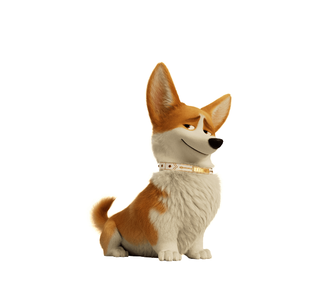
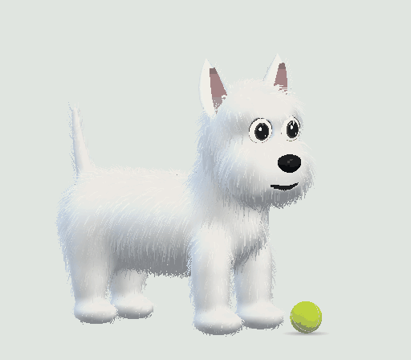
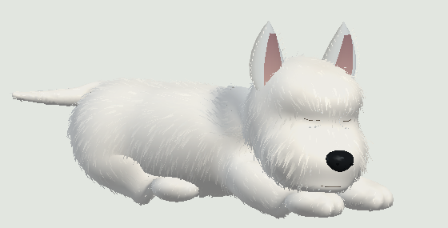

# 小白 · 西高地桌面宠物

在 Windows 桌面陪伴你的小狗，支持在西高地和柯基之间自由切换。使用 C# 和 WPF 实现透明桌面窗口：西高地使用实时 3D 模型，高清柯基使用 2.5D 立绘骨骼动画。

西高地模型由程序生成；高清柯基素材随程序嵌入。运行时不需要另外下载 `.glb`、`.fbx`、图片或模型服务。

西高地保留用户选定的旧版外观：原有眼白比例、脸型、毛发、光照和嘴部表情，以及后续动作与交互修复。高清柯基根据用户选择的“毛发质感优先”方向，直接使用用户提供的透明 PNG 立绘，保留原图的毛发、眼鼻材质与光影，通过局部网格骨骼做呼吸、眨眼和坐姿互动。[查看柯基素材与呈现方式](docs/corgi-reference-study.md)，或[查看西高地效果和动作小样](docs/visual-study.md)。





## 下载使用

前往 [Releases](https://github.com/z1225037649-cmd/westie-desktop-pet/releases) 下载 Windows 便携版，解压后双击 **小白-西高地桌面宠物.exe**。

- 适用环境：Windows 10 / 11，启用了 WPF 的 .NET Framework 4.x。
- 无需安装，也不需要管理员权限；请放在可以写入文件的普通文件夹中。
- 首次运行打开“小白的小窝”；关闭小窝后，桌面宠物仍会继续运行。
- 托盘图标可以打开小窝、找回小狗或退出。

## 可以做什么

- 在小窝的“宠物模型”下拉框，或右键菜单的“宠物模型”子菜单中，即时切换西高地和柯基；桌面小狗和小窝预览会同步更新。
- 模型选择会保存，重启后自动恢复；切换时保留名字、摸摸和喂食次数、位置及大小。
- 高清柯基为坐姿 2.5D 动画，可呼吸、眨眼、轻蹭、点头、配合饼干与网球互动，并坐着打盹；朝向切换使用镜像。当前没有完整转身、四足步行、自由散步或趴睡动作。
- 拖动小狗调整位置，滚轮调整大小。
- 触碰小狗后，通过操作条摸摸、喂食、玩球或打开小窝。
- 在小窝里让它睡觉、叫醒；西高地还可切换自由散步。切换到高清柯基时暂停散步，保留西高地原来的散步设置。
- 小白支持自定义名字，并会保存摸摸和喂食次数；全屏应用时可自动暂时隐藏，也能从托盘手动隐藏或找回。
- 在小窝里勾选“开机自启动”，让小白在登录 Windows 后自动出现；默认关闭，可随时取消。自启动时只显示桌面小狗，手动打开仍会显示小窝。
- 摸摸时，西高地会眯眼、左右蹭头、放松耳朵并摇尾巴；高清柯基用局部骨骼做轻蹭与耳尾小动。
- 喂食时，小饼干靠近嘴边并逐口变小。西高地会低头咬食、咀嚼并掉落碎屑；高清柯基以坐姿点头配合饼干道具。
- 玩球时，西高地前爪轻拨立体网球；高清柯基保留坐姿并配合网球道具互动。
- 睡觉时，西高地伏低身体、收起四肢、闭眼闭嘴并保留呼吸起伏；高清柯基低头闭眼，保持坐姿打盹。
- 支持置顶、多显示器位置限制和屏幕外位置恢复。
- 鼠标操作区域贴合小狗轮廓，减少点击空白区域时拦截桌面操作。睡觉时动画降频以减少后台开销。



快捷键在宠物窗口获得焦点时生效：

| 操作 | 快捷键 |
| --- | --- |
| 摸摸 | 空格 |
| 喂食 | F |
| 玩球 | B |
| 睡觉 / 叫醒 | S |
| 切换自由散步（西高地） | R |
| 收起操作条 / 取消拖动 | Esc |

右键小狗可打开完整菜单。模型选择、名字、互动次数、大小、位置和散步设置保存在程序旁的 `小白.settings.xml`，该文件不会提交到仓库。旧设置缺少模型选择，或模型值无法识别时，会安全回退到西高地。

如果小狗点不动或突然消失，请保留程序旁的 `runtime.log`（本地运行状态、鼠标输入、界面长时间停顿和退出记录）以及可能存在的 `error.log`。运行记录限制在约 256 KB 内，不会放入分享包。

开机自启动只为当前 Windows 用户设置，无需管理员权限。启动项指向开启时的程序位置；如果移动了程序文件夹，请在新位置重新关闭并开启此选项。

## 从源码构建

需要 Windows 上的 .NET Framework 4.x 编译器及 WPF 程序集。构建脚本直接调用系统 `csc.exe`，无需 NuGet、Node.js 或模型下载。

在仓库根目录打开 PowerShell，运行：

```powershell
powershell -NoProfile -ExecutionPolicy Bypass -File .\build.ps1
```

每次更新代码后都必须运行构建脚本。脚本会更新根目录的 `小白-西高地桌面宠物.exe`，并自动同步便携版解压目录中的程序和使用说明、ZIP、校验和与发布说明，同时刷新解压目录的修改时间。若程序正在运行，请先从托盘菜单退出，再重新构建。

对外分享 **`dist/WestiePet-v0.1.0-windows.zip`**。压缩包仅包含程序和使用说明，不包含个人设置、日志或测试文件。交付前应核对包内 EXE 与根目录 EXE 的 SHA-256 一致。

构建后可运行只读验证脚本，核对根目录、便携目录与 ZIP 内 EXE 的哈希、说明文本、压缩包文件清单、校验和及目录时间：

```powershell
powershell -NoProfile -ExecutionPolicy Bypass -File .\qa\VerifyPortable.ps1
```

如需更改版本，可传入 `-Version 0.1.1`；正式调整默认版本时，同步更新脚本默认值与本文分享包名称。便携版使用说明和发布说明分别维护在 `docs/portable-readme.txt`、`docs/release-notes.md`，构建时会替换版本号。

## 检查与渲染

```powershell
powershell -NoProfile -ExecutionPolicy Bypass -File .\qa\run.ps1
```

检查内容包括屏幕边界、全屏识别、配置数值与名字容错，以及西高地的转头平滑、散步暂停、玩球时身体高度、摸摸蹭头眯眼、喂食咀嚼与饼干消耗、六种状态的透明画面渲染与互动状态切换。西高地的摸摸、喂食还会输出去除文字和符号的连续动作帧。

模型检查覆盖西高地与高清柯基的即时切换、桌面与小窝预览同步、切换前后设置保留、配置模型值回退，以及各自支持的互动状态渲染与画面边界。高清柯基的立绘动画检查不代表具备完整 3D 转身、四足步行或趴睡动作。

输入检查覆盖 40%、57%、100%、160% 大小时的小狗轮廓命中，以及轮廓外空白区域、点击摸摸、释放捕获、缺少中间移动事件的快速拖动和右键菜单，避免动态三维网格重新进入桌面输入路径。

自启动检查使用独立的临时注册表键，验证默认关闭、开启、取消、路径含空格和中文、移动程序及写入失败，不会更改实际开机启动项。

可选的西高地多角度模型渲染：

```powershell
powershell -NoProfile -ExecutionPolicy Bypass -File .\qa\run.ps1 -RenderDetails
```

西高地的外形与动作小样可以使用以下命令重现。自然版与动画版仅用于西高地视觉对照，桌面程序默认使用动画版；不会新增或更改个人设置：

```powershell
powershell -NoProfile -ExecutionPolicy Bypass -File .\qa\run.ps1 -VisualStudy
python .\qa\compose_previews.py --visual-study
```

输出位于 `qa/visual-study/`，包括两版有毛和无毛造型的正面、侧面、三分之四视角，以及无气泡、无符号遮挡的待机、拨球和走路小样。渲染工具使用程序中的实际模型和动画，逐帧检查透明背景和全身画面边界。GIF 合成需要 Python 和 Pillow，桌宠本身不依赖它们。

`qa/compose_previews.py` 可将运行自检生成的玩球帧合成为 GIF；这一步需要 Python 和 Pillow，应用本身不依赖 Python：

```powershell
python .\qa\compose_previews.py --frames-dir .\qa\qa
```

预览输出到 `qa/play-preview.gif`；若已运行多角度模型渲染，还会生成 `qa/sleep-preview.png`。

## 源码结构

| 文件 | 内容 |
| --- | --- |
| `Program.cs` | 程序入口、单实例与本地设置 |
| `PetWindow.cs` | 透明窗口、小窝、操作条、托盘和互动状态 |
| `WestieModel.cs` | 西高地模型动画、宠物呈现分支与互动道具 |
| `SculptedCoat.cs` | 程序生成模型的连续表面、毛发与蒙皮变形 |
| `CorgiSprite.cs` | 高清柯基立绘的 2.5D 网格骨骼、局部动作与透明命中 |
| `assets/` | 小窝图标、图标源文件与嵌入的高清柯基素材 |
| `qa/` | 动作检查、渲染工具和交互验证程序源码 |

当前呈现使用 WPF：西高地为实时 3D，高清柯基为用户提供立绘的局部 2.5D 骨骼动画，不是重新建模或新生成的完整连续动作帧。外形和动作仍在迭代，欢迎通过 Issues 提交建议与复现步骤。本轮只生成本地便携包，未上传 GitHub Release。
