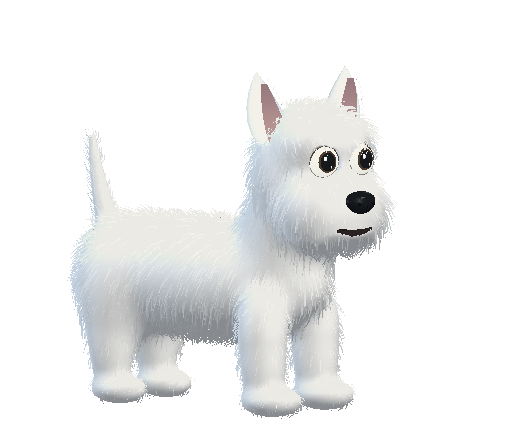
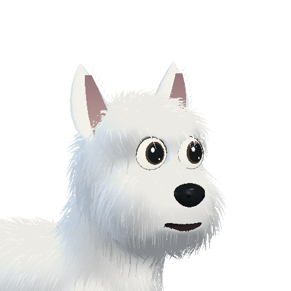
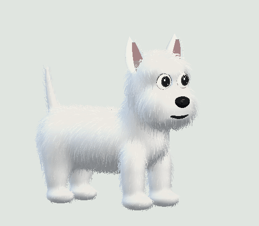
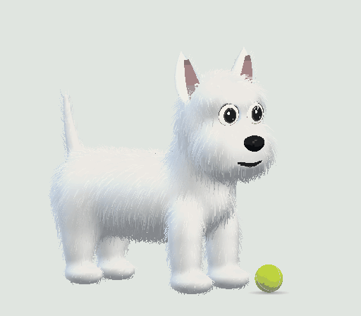

# 小白当前外观：恢复用户选定旧版

日期：2026-11-21。

用户明确选择改造前的旧版截图作为外观基准。当前已恢复旧版的眼白、虹膜和瞳孔比例，以及脸型、体型、毛发、光照和默认嘴部表情；后续新增的动作与交互修复继续保留。

## 当前效果

下图由恢复后的实际模型重新渲染：



脸部近景：



待机与拨球预览：





## 恢复与保留范围

恢复的视觉部分来自改动前的程序模型，与用户提供的旧版参考方向一致：

- 原有的眼孔、眼白、虹膜、瞳孔、高光和眼睑边缘。
- 原有的脸型、身体、后腿和脚掌轮廓。
- 原有的细毛密度、毛长和梳向。
- 原有的明亮白毛光照与略张嘴的默认表情。

保留的功能修复：

- 连续脸部表面完成眨眼、摸摸闭眼与睡眠闭眼。
- 带停顿的待机观察、耳朵响应和短暂摇尾。
- 前爪与球的接触时间线，以及真实三角面接触检查。
- 从睡眠切到玩球时先起身站稳，再显示球开始动作。
- 连续点击时明确通知模型重启动作。
- 原有输入轮廓、快速拖动、托盘、自启动与个人设置功能。

## 检查标准

眼部检查已改为用户选定旧版的参考区间，并分别验证可见眼白、虹膜和高光。参考图为仓库内的 [旧版脸部](images/approved-legacy-face.png) 与 [旧版全身](images/approved-legacy-full.png)，可在新检出目录重现。

闭眼、摸摸、睡眠与醒来仍检查实际可见像素，避免虹膜或高光从脸部漏出；不再以“黑色面积越小越好”作为审美目标。外观是否符合预期，以用户提供的旧版视觉基准为准。

## 复现与分享

```powershell
powershell -NoProfile -ExecutionPolicy Bypass -File .\qa\run.ps1 -RenderDetails -VisualStudy
python .\qa\compose_previews.py --visual-study
powershell -NoProfile -ExecutionPolicy Bypass -File .\build.ps1
powershell -NoProfile -ExecutionPolicy Bypass -File .\qa\VerifyPortable.ps1
```

研究渲染使用约30Hz采样，分享GIF约15Hz；桌面程序仍按活动状态56毫秒、睡眠150毫秒的目标间隔更新。离屏动画不代表实际桌面显示帧率。

对外分享 `dist/WestiePet-v0.1.0-windows.zip`。ZIP只含程序与使用说明，不含研究图、日志、设置或测试产物。本机便携目录内已有的个人设置与日志继续保留。

此前的自然/动画造型、小眼方案与照片参考为历史探索，不再作为当前默认外观要求。
