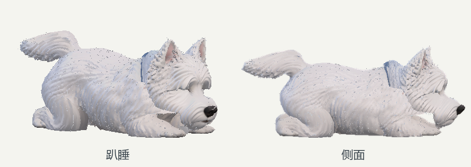

# 生成西高地桌宠接入

2026-11-22。默认西高地使用用户提供的 `dog_model.glb`，原始文件与 SHA-256 保持不变。柯基切换、个人设置及通用桌面功能继续保留。

## 实际资源与实现

- `assets/westie-generated.mesh`：保留原体型的三维网格，按脸部、材质和 UV 分区减面。UV 分区共享几何位置，避免接缝开裂。
- 皮肤 48,028 个顶点、59,830 个三角面，新增 3,500 束细毛；含高光共58,682个顶点、63,570个三角面。细毛在减面表面扎根，使用根部贴图颜色并继承根部骨骼权重。
- `assets/westie-generated.png`：原 GLB 内的 4096×4096 颜色贴图，原样嵌入。WPF 使用漫反射和克制的高光；不支持原 GLB 的完整 PBR 法线及金属粗糙度流程。
- `GeneratedWestie.cs`：九个解析蒙皮控制区，包括身体、头、颈、四肢、尾和下颌。呼吸、转头、眨眼、摸摸、咀嚼、拨球、四足摆动和伏低睡姿均直接变形当前显示的真实网格。
- 眼部高光是小型附加几何，随头部变形，并在闭眼时隐藏。眼裂通过原纹理表面的连续压缩闭合。
- 食物和球使用当前嘴部与爪部的世界坐标。玩球时固定朝向，接触前球静止，爪面接触后滚动减速；睡醒后先恢复站姿。
- 鼠标使用当前已变形皮肤的稀疏表面点，直接投影到可复用二维命中掩码，实时跟随腿、爪、尾和睡姿。窗口每帧不再为命中同步渲染整只狗，鼠标事件也不遍历三维网格。

这是为桌面交互制作的基础蒙皮。清醒动作使用每腿一个控制区；睡姿保留躯干体积，四腿使用上肢、下肢及平放脚掌的分段映射。尚无完整专业骨架、足底 IK、嘴内牙齿舌头或面部表情骨骼。

## 2026-11-26 睡眠节拍与小窝拖动

此前进入sleep后立即改用150ms定时器，日志中入睡过程和提示只有约6–7次更新/秒。现在两种生产模型的绘制回调和定时器共用30Hz截止时间；西高地入睡和醒来持续更新，进入sleep至少3秒且姿态收敛到.999后，仅网格与命中轮廓降为约6–7Hz，睡眠提示继续30Hz。

小窝通过原生WM_ENTERSIZEMOVE/WM_EXITSIZEMOVE暂停、恢复动画。拖动时取消绘制订阅，仅以100ms服务节拍处理窗口服务，保留当前网格和提示；结束时顺延动作起点、截止时间、气泡和自动互动时间。关闭期间退出移动状态，重开后重新安装消息钩子。

`./qa/run.ps1 -CadenceOnly`在独立屏幕外验证窗口中交错调用真实绘制和定时器入口，观察实际更新时间、姿态、提示位置和几何对象。西高地入睡28.87次模型更新/秒、醒来30.10次/秒；睡稳模型6.18次/秒，提示29.93次/秒。两狗拖动暂停、四项计时补偿、重复消息与关闭重开检查通过。这些数值是应用更新节拍，不是GPU呈现帧率；回归中的原生消息由测试主动发送。

## 2026-11-25 体积与操作性能

后续性能优化保留现有模型、贴图、顶点数和动画刷新目标：骨骼矩阵每帧预展开一次，闭眼曲线的顶点位移预缓存，命中轮廓对同一个像素中心只绘制一次。全屏检测约每200ms检查一次（隐藏时受350ms服务定时器限制）；不再给不可见特效重复分配画刷或更新位置。散步先提交当前帧的几何与命中轮廓，再更新窗口位置，气泡随LocationChanged统一定位。

同一252帧基准，优化前整体中位10.34ms、95分位12.41ms；本轮完整模型回归后中位8.51ms、95分位11.09ms，后续移动提交顺序检查也通过。每帧几何分配仍约2.82MB；复用可变WPF集合的方案实测更慢，因此保留冻结集合。模型更新目标仍约30Hz；这些CPU数值不是GPU显示帧率。

新增 `qa/run.ps1 -WindowPerformance -PerformanceAssembly <EXE> -PerformanceOutput <目录>`，独立进程加载指定程序集，分别测静止、原地走、移动前/后提交动画、小窝预览。测试使用屏幕外窗口且不写个人设置，其窗口移动测量受屏幕外遮挡影响，只用于对比同步工作，不能替代真实桌面帧率。`GeneratedFrameChecks` 另调用真实Tick验证窗口位移与四肢相位一起前进。

最终EXE的独立窗口诊断（每场景90帧）：静止同步工作中位由9.80降至8.00ms，小窝打开由9.23降至8.22ms。优化版中移动后提交模型的同步总耗时中位10.24ms、95分位18.63ms，改为先提交模型再移动后为9.05ms、10.43ms，因此生产Tick采用后者。测试驱动受后台优先级和屏幕外窗口调度影响，回调率不作用户可见帧率结论。报告保存在 `qa/performance-before/window/`、`qa/performance-after/window/`；最终核心帧回归为中位8.20ms、95分位9.39ms，真实Tick位移及四肢相位检查通过。

上一次消除胸腿交叉时使用了过强的连续压缩，用户截图显示胸前像折叠纸片。当前取消该压缩：躯干保持刚性体积，只随根部降低0.30；四肢分段屈曲，关节插值后归一化旋转，前肘向两侧展开，脚掌水平贴地。颈部前倾45度，头部最终俯角约18度，并向前留出0.08的空间。

放松睡姿允许头部略抬，终态下巴到前爪的最大间隙由0.12调整为0.30；最小间隙、实际三角面交叉及脚底检查保留。新增胸部顶点协方差行列式的平方根作为旋转不变的空间体积指标，门槛0.55：上一次折叠版仅0.233，当前0.642。它是体积代理指标，不是封闭网格的物理体积。18个睡醒采样的胸部新增穿入均小于0.002世界单位，头颈新增相交为0；四肢支撑、脚底、眼部、食物、拨球和鼠标轮廓检查全部通过。

为降低操作负担，重新减面并减少细毛束数，保留原4096贴图；蒙皮矩阵按引用传递，提交到WPF的顶点和法线集合冻结。模型切换的36步姿态收敛只在最后更新一次几何；小窝预览禁用三维鼠标命中；拖动时保持已渲染姿态，给窗口输入留出计算时间。

最终 `GeneratedOnly` 检查：252帧生产动画加输入轮廓，各动作中位9.75–11.10ms、95分位不超过12.93ms，每帧核心分配约2.82MB（此前约4.12MB）。1000次小窝真实输入命中5.33ms，缓存模型切换中位6.61ms、最大33.13ms。实际交互验证窗口稳定待机平均约10–11ms、29.7–30.0次更新/秒；日志记录了拖动、喂食、玩球和打开小窝。测试中的瞬时切换、拖动和首次加载仍会影响间隔；这些数值不代表GPU呈现帧率。

收尾移除模型切换中最后一次多余几何提交后，`-FrameOnly` 再次通过：核心各动作中位7.87–9.59ms，缓存切换中位2.54ms、最大24.50ms。不同轮次受系统负载影响，以上保留完整模型回归与收尾复测的分别记录。

`qa/run.ps1 -GeneratedOnly` 覆盖模型与性能，`-FrameOnly` 可单独复测性能。最新渲染见下图；下文按时间保留此前实现与测量，不代表当前姿态参数。



## 复现

```powershell
python tools/export_generated_westie.py
./qa/run.ps1 -GeneratedOnly
./build.ps1
./qa/VerifyPortable.ps1
```

导出只读取项目内原始 GLB，不需启动 Blender。原始 Blender 工程仍保留为导入审查工程；当前运行绑定在 C# 中，未将其误标为已经绑定的 Blender 工程。

`qa/generated/` 保存真实程序渲染、眼部像素对照、球面接触样本、性能和结果。`GeneratedChecks` 检查当前生产模型；旧 `MotionChecks` / `EyeChecks` 使用明确的编译标记保留为旧程序造型的研究检查。

受限环境可显式使用 `./qa/run.ps1 -SkipRegistryChecks`，其输出会标注跳过临时注册表自启动检查，不能作为该检查通过。它不跳过新模型、切换、输入或应用自检。

本轮更新根目录 EXE、便携目录、ZIP、校验和与发布说明；没有上传 GitHub Release。

## 初次接入验证（卡顿修复前）

- 当前生产模型的八组检查全部通过，包括六状态完整画面、两视角实际眼部像素、四足暂停/睡醒、食物、爪面与球面接触、移动轮廓输入和性能。
- 动画更新中位 7.78 ms，95 分位 8.43 ms；根目录程序于 20:21 启动，日志记录 `visible=True`，进程正常响应。
- 柯基及模型切换、个人状态和配置保留、主程序自检全部通过。初次受限检查跳过临时注册表测试；切换为“请求批准”后，独立自启动注册表检查已通过。
- 20:41 使用桌面工具重新启动同一份新版程序，已实际捕获小窝与生成西高地模型；用户的桌面拖动输入生效。此前在 sandbox 用户下启动的实例已停止，用户随后调整的位置得到保留。
- 便携包十项一致性检查通过。ZIP 仅含 EXE 和 README，根目录/便携目录/ZIP 内 EXE 哈希一致，说明文本与校验和一致，目录时间已刷新。
- EXE SHA-256：`6eaa1ed7fd5583a654f7a2956ecc47a922146c60e64a1d38de2a5e47f747d2a2`。
- ZIP SHA-256：`a610bc4928326cf8fe759e3e81f0bb6c0162820845afe3ac5a72892fc41e470e`。


## 动作卡顿修复

用户在实际桌面反馈动作非常卡。原先的性能报告只测 `WestieModel.Animate`，没有包含冷姿态时 `UpdateGeneratedHitArea` 的整狗同步离屏绘制。独立基线使用旧程序集测到：动画本身约 9–10 ms，轮廓更新约 590–680 ms，完整核心更新约 602–690 ms。

当前修复直接复用真实蒙皮后的稀疏表面点，在 306×260 的固定缓冲中生成命中掩码；不分配姿态位图，也不再调用 `RenderTargetBitmap` 做轮廓更新。边界在蒙皮遍历时累计，避免互动气泡再次扫描整个网格。西高地清醒动画目标间隔改为 33 ms，睡眠保持降频。

`GeneratedFrameChecks` 对 252 帧连续变更的朝向、摸摸、喂食、拨球、走路、睡眠和醒来执行生产动画与轮廓更新，没有预热姿态缓存捷径。首次修复测量中位 12.78 ms，95 分位 15.84 ms，最大 17.67 ms；输入更新中位 1.89 ms。所有新增摸摸/喂食/醒来以及原有四种缩放、两种朝向的真实像素覆盖检查通过，命中阈值未放宽。

这些数值描述 CPU 核心更新，不等于 GPU 实际呈现帧率。`runtime.log` 增加动作分段的 UI 更新平均/最大耗时、最大 tick 间隔、tick 频率和 WPF render tier，用于真实桌面继续核对。日志仍有原来的大小限制，个人设置与日志不进入便携 ZIP。

真实窗口初次采样显示固定后台定时器只达到约17–20次更新/秒，因此进一步改为随 `CompositionTarget.Rendering` 绘制回调更新清醒西高地，并与服务定时器共享30Hz时间门控。睡眠、隐藏、模型切换及退出时取消该回调，柯基保持其独立动画帧间隔。2秒交错回调测试观测到60次实际模型更新（29.9Hz），没有紧邻重复更新；此数值仍不是GPU呈现帧数。

## 趴睡姿势修复

用户截图确认原前爪旋转后脚掌抬到胸口附近。只把脚掌放回地面仍会留下直立腿和奇怪的屈膝轮廓，因此现在用上肢、下肢及脚掌三个连续区域分别映射：前肘下落、前足向前放平，后膝下落并收拢到身体两侧，腹部整体落低。关节区插值后归一化旋转，避免肢体截面压成薄片；脚掌真实几何和对应锚点同步，醒来平滑恢复。

后脑和耳根原先部分绑定在身体上，重新导出时修正头部权重范围，同时排除背部，保持原始网格、UV及贴图。睡姿头部俯角由约54度改为约8度，并整体向下放低，口鼻朝前、下巴接近前爪。胸口另外前倾6度，使前胸落低；腹部与毛发在同一地面上停住。原始 GLB SHA-256 保持 `7d440cb75ba688d5eb3101431973d6fc71e0c9ec4c3f3ab7b79d00e1958e2965`。

固定睡姿的加权顶点与法线在初始化时缓存。运行中只把它们与清醒骨骼贡献混合，避免每帧重新计算分段关节。

检查直接追踪同一脚掌顶点、脚垫三角面及四条腿的中段，验证贴地、平放、屈腿与腹部相对高度、前爪和头嘴网格间隙、进入/退出睡眠各阶段及醒来回位。前/侧/52度斜侧面使用实际生产场景渲染检查，复现命令为 `./qa/render-generated-sleep.ps1`；诊断渲染本身不替代回归检查。

23:09中间版姿态检查：2940个脚掌顶点全部贴地，802个脚底三角面全部保持平放，腹部最低Y为0.025；真实下巴至前爪表面间隙0.04462，头/前爪三角面相交数为0，醒来脚掌位置误差0.00194。接触检查使用双方三角面的边/面相交及最短距离，要求进入/退出睡眠各采样阶段均无相交、间隙大于0.005，终态下巴间隙小于0.12，使靠近前爪成为可检验目标。

缓存固定睡姿后，完整CPU帧（动画加输入轮廓）睡眠中位12.26ms、95分位15.99ms；清醒各动作也通过相同预算。2秒交错绘制/定时回调观测到60次实际模型更新、29.93Hz，最小间隔24.42ms，无低于20ms的更新；这仍不表示GPU实际呈现帧率。旧QA按同一串行回调组是否更新两次判重复，会把跨过合法截止时间的第二次更新误报；现在直接核对相邻实际更新时间，保留20ms下限。


## 头颈与尾巴追加修复

用户对23:09版实际反馈颈部穿模及尾巴怪异。新增独立头颈三角面审查后，确认直降头部会在入睡0.25s产生78组新增相交；原头/前爪检查无法覆盖此问题。

现增加颈部控制点，头部使用颈部作为父变换，低头时通过颈部弯曲而非直接竖直平移。头/颈混合区域按关节转角插值并保持旋转长度，避免线性混合矩阵压扁截面；混合比例使用257个旋转采样，最大角度量化误差小于0.13度。入睡时先回正头部，并为后脑保留小幅向前间隙。

按用户最新选择，睡觉时短尾巴保持站立时的原始姿势，只暂停摆动。取消睡眠尾根位移与155度弯折，避免大角度线性蒙皮把尾根截面压薄、产生断裂感；身体整体降低时尾部一起降低，醒来恢复摇尾。原始尾部几何、贴图与毛发保持。

头颈检查比较原始Bind和睡醒各0.25/0.50/0.75/2.40s真实皮肤三角面，排除共享顶点相邻面，要求无新增相交对；CSV保存基线与每阶段的面编号。尾/背亦保存基线与新增相交诊断。`./qa/render-generated-sleep.ps1 -Neck`一次输出全部阶段近景和终态三视图，诊断模式明确不替代回归通过。

最终追加检查通过：37,095个头部三角面与5,079个颈部三角面的原始及八阶段新增相交数均为0；2,974个脚掌顶点贴地，828个足底三角面保持平放，下巴与前爪表面间隙0.02567，醒来回位误差0.00193。尾/背没有新增相交对（原始绑定已有1对，单独记录未冒充新故障）。

眼部近景使用实际累计头/颈矩阵，保持旧8/40度模型朝向对应的0/32度相对眼部观察角度，跟随睡眠回正、俯仰和侧倾；原像素、高光及闭合阈值保持不变。待机、眨眼、摸摸、睡眠及醒来均通过。喂食、球面接触、输入轮廓及恢复检查通过；完整CPU睡眠帧中位13.71ms、95分位17.37ms，实际模型更新29.89Hz，无低于20ms的重复更新。

2026-11-23前次交付：西高地检查、柯基及切换界面检查、实际最终EXE程序自检及便携包一致性检查通过。发现主程序自检的互动步骤会经SaveSettings写个人配置，现统一禁止verify窗口写文件；恢复更新前立即备份，再次执行最终EXE自检，个人配置SHA-256前后完全一致。真实用户进程于00:14:50启动，实际小窝检查了新版西高地趴睡与下垂尾巴，随后恢复用户原柯基选择与睡眠状态，次数、大小及位置保持。

- 前次EXE SHA-256：`10fa290c8e53e867f652f80551c7901fddaa0c8b7b55b1e1f49a601729a2da1a`。
- 前次ZIP SHA-256：`95c45bc1ea2696b15b7cc11b5713896fe3099f5d012f5a75ac0182cfa3402b9e`。
- ZIP与便携目录修改时间：2026-11-23 00:11:09，ZIP仅含EXE与README.txt。

2026-11-23 00:33短尾姿势更新：按用户最新要求，趴睡时保留站立尾姿，只停止摇动；取消睡眠弯折和尾根位移。`qa/run.ps1 -GeneratedOnly`全部通过，实际运行的便携目录程序已更新并于00:33:53重启，小窝实际趴睡画面确认尾根完整、轮廓与站姿一致。更新前后及真实窗口验收后，当前便携配置SHA-256完全一致。

- 该次EXE SHA-256：`ee4eca010aac2e240333b1d63d9ee143816ac503db0e400f2574206e826514c3`。
- 该次ZIP SHA-256：`cc1ee224a505d762d9cabc8cb166ff4bcda485dd83461c5fbb402a6ebd4626d0`。
- ZIP与便携目录修改时间：2026-11-23 00:33:31；VerifyPortable全部通过。

## 2026-11-25 此前胸口与前腿修复（已被体积修复替代）

此前头颈检查没有覆盖下胸及领口内部的自交。扩大到绑定姿态 Y=.30–1.20、Z=.05–.85 的真实胸部皮肤后，旧趴姿发现 1,911 对新增交叉，其中 989 对的穿入深度超过 .002 世界单位，最大 .01412。

胸口中央不再分配给左右前腿。趴睡时，胸口和前腿共用高度单调的连续变形，脚掌向前伸展，胸部中央比两侧前肢更低，避免前肘旋转把皮肤推入胸口。后腿继续使用分段收拢。扩大胸颈和头颈权重过渡，颈部前倾为55度、头部最终俯角约18度，并给头部保留向前间隙；法线按变形的逆转置雅可比计算，皮肤、毛发与爪部锚点同步。

回归在入睡和起身各 .125/.25/.375/.50/.625/.75/1.0/1.5/2.4 秒采样，检查胸部自交、原头颈检查、脚掌贴地、下巴间隙和醒来回位。胸部新检查排除共享几何顶点的 UV 缝，完整记录原始交叉对及深度，拒绝新增穿入深度超过 .002 世界单位的交叉；该精度约为512像素标准视图的0.35像素，不将微小网格交叉隐去或称为数学上的零自交。原头颈零新增交叉要求、头爪间隙和足底阈值保持。

复现专项断言：`./qa/render-generated-sleep.ps1 -Check`；诊断近景与三视图：`./qa/render-generated-sleep.ps1 -Neck`；完整模型与输入/性能回归：`./qa/run.ps1 -GeneratedOnly`。检查报告在 `qa/generated/`，便携包以最新 `dist/SHA256SUMS.txt` 为准。

本次完整回归通过：18个睡醒采样没有超过上述精度的胸部新增交叉，最大穿入深度 .001448；头颈新增交叉为0，2,940个脚掌顶点均低于Y=.20，793/802个足底三角面保持平放，下巴至前爪间隙 .11074，醒来脚掌误差 .00195。眼部、喂食、拨球和输入轮廓均通过；252帧完整CPU更新的各动作中位数低于19ms、95分位低于25ms，实际模型更新约28.98Hz。
