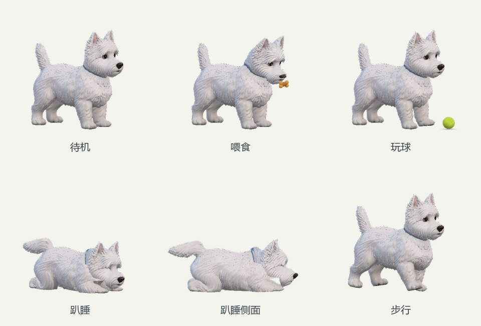

# 生成西高地桌宠接入

2026-11-22。默认西高地使用用户提供的 `dog_model.glb`，原始文件与 SHA-256 保持不变。柯基切换、个人设置及通用桌面功能继续保留。

## 实际资源与实现

- `assets/westie-generated.mesh`：保留原体型的三维网格，按脸部、材质和 UV 分区减面。UV 分区共享几何位置，避免接缝开裂。
- 皮肤 88,216 个三角面，新增 6,500 束细毛；细毛在减面表面扎根，使用根部贴图颜色并继承根部骨骼权重。
- `assets/westie-generated.png`：原 GLB 内的 4096×4096 颜色贴图，原样嵌入。WPF 使用漫反射和克制的高光；不支持原 GLB 的完整 PBR 法线及金属粗糙度流程。
- `GeneratedWestie.cs`：八个解析蒙皮控制区，包括身体、头、四肢、尾和下颌。呼吸、转头、眨眼、摸摸、咀嚼、拨球、四足摆动和伏低睡姿均直接变形当前显示的真实网格。
- 眼部高光是小型附加几何，随头部变形，并在闭眼时隐藏。眼裂通过原纹理表面的连续压缩闭合。
- 食物和球使用当前嘴部与爪部的世界坐标。玩球时固定朝向，接触前球静止，爪面接触后滚动减速；睡醒后先恢复站姿。
- 鼠标使用当前已变形皮肤的稀疏表面点，直接投影到可复用二维命中掩码，实时跟随腿、爪、尾和睡姿。窗口每帧不再为命中同步渲染整只狗，鼠标事件也不遍历三维网格。

这是为桌面交互制作的基础蒙皮。清醒动作使用每腿一个控制区；睡姿另外使用上肢、下肢及平放脚掌的连续分段映射。尚无完整专业骨架、足底 IK、嘴内牙齿舌头或面部表情骨骼。

## 复现

```powershell
python tools/export_generated_westie.py
./qa/run.ps1 -GeneratedOnly
./build.ps1
./qa/VerifyPortable.ps1
```

导出只读取项目内原始 GLB，不需启动 Blender。原始 Blender 工程仍保留为导入审查工程；当前运行绑定在 C# 中，未将其误标为已经绑定的 Blender 工程。

`qa/generated/` 保存真实程序渲染、眼部像素对照、球面接触样本、性能和结果。`GeneratedChecks` 检查当前生产模型；旧 `MotionChecks` / `EyeChecks` 使用明确的编译标记保留为旧程序造型的研究检查。

受限环境可显式使用 `./qa/run.ps1 -SkipRegistryChecks`，其输出会标注跳过临时注册表自启动检查，不能作为该检查通过。它不跳过新模型、切换、输入或应用自检。

本轮更新根目录 EXE、便携目录、ZIP、校验和与发布说明；没有上传 GitHub Release。

## 初次接入验证（卡顿修复前）

- 当前生产模型的八组检查全部通过，包括六状态完整画面、两视角实际眼部像素、四足暂停/睡醒、食物、爪面与球面接触、移动轮廓输入和性能。
- 动画更新中位 7.78 ms，95 分位 8.43 ms；根目录程序于 20:21 启动，日志记录 `visible=True`，进程正常响应。
- 柯基及模型切换、个人状态和配置保留、主程序自检全部通过。初次受限检查跳过临时注册表测试；切换为“请求批准”后，独立自启动注册表检查已通过。
- 20:41 使用桌面工具重新启动同一份新版程序，已实际捕获小窝与生成西高地模型；用户的桌面拖动输入生效。此前在 sandbox 用户下启动的实例已停止，用户随后调整的位置得到保留。
- 便携包十项一致性检查通过。ZIP 仅含 EXE 和 README，根目录/便携目录/ZIP 内 EXE 哈希一致，说明文本与校验和一致，目录时间已刷新。
- EXE SHA-256：`6eaa1ed7fd5583a654f7a2956ecc47a922146c60e64a1d38de2a5e47f747d2a2`。
- ZIP SHA-256：`a610bc4928326cf8fe759e3e81f0bb6c0162820845afe3ac5a72892fc41e470e`。



## 动作卡顿修复

用户在实际桌面反馈动作非常卡。原先的性能报告只测 `WestieModel.Animate`，没有包含冷姿态时 `UpdateGeneratedHitArea` 的整狗同步离屏绘制。独立基线使用旧程序集测到：动画本身约 9–10 ms，轮廓更新约 590–680 ms，完整核心更新约 602–690 ms。

当前修复直接复用真实蒙皮后的稀疏表面点，在 306×260 的固定缓冲中生成命中掩码；不分配姿态位图，也不再调用 `RenderTargetBitmap` 做轮廓更新。边界在蒙皮遍历时累计，避免互动气泡再次扫描整个网格。西高地清醒动画目标间隔改为 33 ms，睡眠保持降频。

`GeneratedFrameChecks` 对 252 帧连续变更的朝向、摸摸、喂食、拨球、走路、睡眠和醒来执行生产动画与轮廓更新，没有预热姿态缓存捷径。首次修复测量中位 12.78 ms，95 分位 15.84 ms，最大 17.67 ms；输入更新中位 1.89 ms。所有新增摸摸/喂食/醒来以及原有四种缩放、两种朝向的真实像素覆盖检查通过，命中阈值未放宽。

这些数值描述 CPU 核心更新，不等于 GPU 实际呈现帧率。`runtime.log` 增加动作分段的 UI 更新平均/最大耗时、最大 tick 间隔、tick 频率和 WPF render tier，用于真实桌面继续核对。日志仍有原来的大小限制，个人设置与日志不进入便携 ZIP。

真实窗口初次采样显示固定后台定时器只达到约17–20次更新/秒，因此进一步改为随 `CompositionTarget.Rendering` 绘制回调更新清醒西高地，并与服务定时器共享30Hz时间门控。睡眠、隐藏、模型切换及退出时取消该回调，柯基保持其独立动画帧间隔。2秒交错回调测试观测到60次实际模型更新（29.9Hz），没有紧邻重复更新；此数值仍不是GPU呈现帧数。

## 趴睡姿势修复

用户截图确认原前爪旋转后脚掌抬到胸口附近。只把脚掌放回地面仍会留下直立腿和奇怪的屈膝轮廓，因此现在用上肢、下肢及脚掌三个连续区域分别映射：前肘下落、前足向前放平，后膝下落并收拢到身体两侧，腹部整体落低。关节区插值后归一化旋转，避免肢体截面压成薄片；脚掌真实几何和对应锚点同步，醒来平滑恢复。

后脑和耳根原先部分绑定在身体上，重新导出时修正头部权重范围，同时排除背部，保持原始网格、UV及贴图。睡姿头部俯角由约54度改为约8度，并整体向下放低，口鼻朝前、下巴接近前爪。胸口另外前倾6度，使前胸落低；腹部与毛发在同一地面上停住。原始 GLB SHA-256 保持 `7d440cb75ba688d5eb3101431973d6fc71e0c9ec4c3f3ab7b79d00e1958e2965`。

固定睡姿的加权顶点与法线在初始化时缓存。运行中只把它们与清醒骨骼贡献混合，避免每帧重新计算分段关节。

检查直接追踪同一脚掌顶点、脚垫三角面及四条腿的中段，验证贴地、平放、屈腿与腹部相对高度、前爪和头嘴网格间隙、进入/退出睡眠各阶段及醒来回位。前/侧/52度斜侧面使用实际生产场景渲染检查，复现命令为 `./qa/render-generated-sleep.ps1`；诊断渲染本身不替代回归检查。

最终姿态检查：2940个脚掌顶点全部贴地，802个脚底三角面全部保持平放，腹部最低Y为0.025；真实下巴至前爪表面间隙0.04462，头/前爪三角面相交数为0，醒来脚掌位置误差0.00194。接触检查使用双方三角面的边/面相交及最短距离，要求进入/退出睡眠各采样阶段均无相交、间隙大于0.005，终态下巴间隙小于0.12，使靠近前爪成为可检验目标。

缓存固定睡姿后，完整CPU帧（动画加输入轮廓）睡眠中位12.26ms、95分位15.99ms；清醒各动作也通过相同预算。2秒交错绘制/定时回调观测到60次实际模型更新、29.93Hz，最小间隔24.42ms，无低于20ms的更新；这仍不表示GPU实际呈现帧率。旧QA按同一串行回调组是否更新两次判重复，会把跨过合法截止时间的第二次更新误报；现在直接核对相邻实际更新时间，保留20ms下限。


